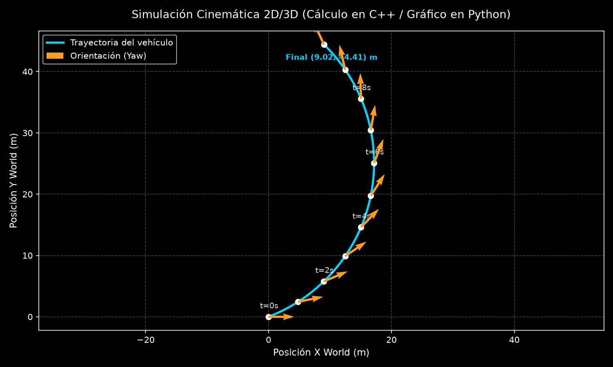

# Simulación Cinemática 2D/3D de Vehículo en C++

Simulador básico escrito en C++ que modela el movimiento cinemático de un vehículo en el plano horizontal (con soporte para coordenada vertical `Z`), realizando la transformación de velocidades desde el sistema de referencia local (**Body Frame**) al sistema global (**World Frame**) mediante integración numérica de Euler.



## Características principales

* **Transformación de marcos de referencia:** Conversión de vectores de velocidad lineal local (\(v_x, v_y, v_z\)) a coordenadas globales según el ángulo de guiñada (*yaw*, ψ).
* **Integración numérica:** Actualización discreta de posición y orientación paso a paso con un intervalo de tiempo fijo (Δ t = 0.1 s).
* **Salida formateada:** Reporte periódico en consola cada 1 segundo simulado mostrando posición global, velocidad global y ángulo de orientación en grados.

## Modelo Matemático

En cada paso de tiempo Δ t, el sistema transforma la velocidad local del vehículo al marco global aplicando una matriz de rotación 2D alrededor del eje vertical Z:

\[v_{world, x} = \cos(\psi) \cdot v_{body, x} - \sin(\psi) \cdot v_{body, y}\]

\[v_{world, y} = \sin(\psi) \cdot v_{body, x} + \cos(\psi) \cdot v_{body, y}\]

\[v_{world, z} = v_{body, z}\]

Posteriormente, se actualizan la posición global y la orientación mediante el método de Euler explícito:

\[\mathbf{p}(t + \Delta t) = \mathbf{p}(t) + \mathbf{v}_{world} \cdot \Delta t\]

\[\psi(t + \Delta t) = \psi(t) + \omega_z \cdot \Delta t\]

## Parámetros de la Simulación por Defecto

| Parámetro | Valor inicial | Unidad |
| :--- | :--- | :--- |
| **Posición inicial** | `(0.0, 0.0, 0.0)` | m |
| **Velocidad Body** | `(5.0, 2.0, 0.0)` | m/s |
| **Orientación inicial (Yaw)** | `0.0` | rad |
| **Velocidad angular (\(\omega_z\))** | `0.2` | rad/s |
| **Paso de tiempo (Δ t)** | `0.1` | s |
| **Tiempo total** | `10.0` | s |

## Requisitos y Compilación

Solo necesitás un compilador estándar de C++ (como `g++`, `clang++` o MSVC). No requiere librerías externas.

### En Linux / macOS / Windows (MinGW)
1. Cloná este repositorio o descargá el archivo fuente (`main.cpp`).
2. Abrí una terminal en la carpeta del proyecto y compilá el código:
   ```bash
   g++ -std=c++17 -O2 main.cpp -o simulacion
   ```
3. Ejecutá el programa:
   ```bash
   ./simulacion
   ```
   *(En Windows PowerShell o CMD ejecutá `simulacion.exe`)*

## Ejemplo de Salida en Consola

```text
SIMULACION CINEMATICA 2D/3D
---------------------------

Tiempo: 1.0000 s
Posicion World: (4.4926, 2.5734, 0.0000) m
Velocidad World: (3.8511, 3.7604, 0.0000) m/s
Yaw: 11.4592 grados
...
```

## Cómo convertirlo en un simulador gráfico

Si querés visualizar esta simulación en movimiento real en tu computadora, tenés dos caminos sencillos:
1. **Gráficos en tiempo real en C++:** Integrar el bucle `for` dentro de una ventana usando librerías ligeras como **Raylib** o **SFML**, dibujando un rectángulo rotado según `vehiculo.yaw` en las coordenadas `(vehiculo.posicion.x, vehiculo.posicion.y)`.
2. **Exportación a CSV + Python:** Guardar los valores de cada iteración en un archivo `datos.csv` usando `<fstream>` y graficar la animación con `matplotlib` en Python.
